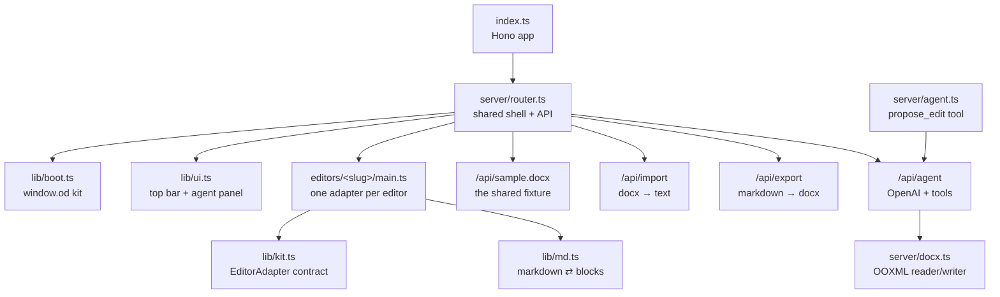
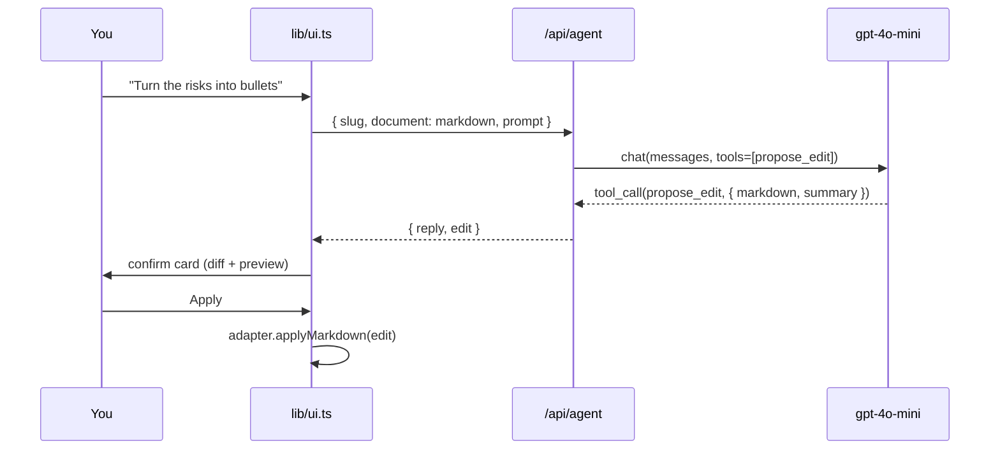

# open-docs

A bench of open-source document editors that run **entirely in the browser**, each
loaded from npm/CDN with no build step, each with real `.docx` import/export and
an editing agent.

Every editor gets the same treatment so the comparison is fair: the same fixture
document, the same top bar, the same agent panel, the same export path. The
differences you see are the libraries' differences, not the demo's.

| Editor | Package | Renders | DOCX import/export | Agent write path |
| --- | --- | --- | --- | --- |
| [canvas-editor](url:e/canvas-editor) | `@hufe921/canvas-editor@1.1.0` | Canvas/SVG | **hand-written** (see below) | rebuild element list |
| [Docxodus](url:e/docxodus) | `docxodus@15.1.0` | .NET/WASM → HTML | native, lossless | `session.replaceText(anchor, md)` |
| [SuperDoc](url:e/superdoc) | `superdoc@2.29.0` | Vue | native | editor command API |
| [Plate](url:e/plate) | `platejs@53.5.2` | Slate/DOM | via `@platejs/docx-io` | `tf.replaceNodes` |
| [docen](url:e/docen) | `docen@0.7.0` | Canvas (Leafer) | native **and** markdown | `el.openMarkdown` |
| [office-open](url:e/office-open) | `office-open@0.15.1` | none — JSON model | `parseDocument`/`generateDocument` | the model *is* the agent output |
| [docx-editor.dev](url:e/eigenpal) | `@docx-editor.dev/react@2.35.0` | React | native, lossless | regenerate + reopen |
| [folio](url:e/folio) | `@stll/folio-vue@0.28.0` | ProseMirror | native + markdown | `applyFolioAIEditOperations` |

## Quick start

Open the [landing page](url:index.ts) and pick an editor, or jump straight to one:

- [canvas-editor](url:e/canvas-editor) · [Docxodus](url:e/docxodus) ·
  [SuperDoc](url:e/superdoc) · [Plate](url:e/plate) · [docen](url:e/docen) ·
  [office-open](url:e/office-open) · [docx-editor.dev](url:e/eigenpal) ·
  [folio](url:e/folio)

Each page has **Import .docx**, **Export .docx**, **Reset**, and an agent panel.

## How it fits together



### The adapter contract

Each editor folder only implements [the four methods in `lib/kit.ts`](url:lib/kit.ts):

```ts
interface EditorAdapter {
  name: string;
  mount(): Promise<void>;                    // render the fixture
  applyMarkdown(markdown: string): Promise<void>;  // the agent's write
  getMarkdown(): Promise<string>;            // read it back
  exportDocx?(): Promise<Uint8Array>;        // native bytes, if the lib has them
  importDocx?(bytes: Uint8Array): Promise<void>;    // native open, if it has one
}
```

Omit `exportDocx`/`importDocx` and the shared chrome falls back to the
server-side OOXML path — which is exactly what makes the `docxRoundTrip`
column above meaningful rather than decorative.

Adding an editor is three files:

```
editors/<slug>/shell.ts   # slug, title, body markup — runs on the server
editors/<slug>/main.ts    # the adapter — runs in the browser
editors/<slug>/…          # anything else the adapter needs
```

…plus one line in [`editors/index.ts`](url:editors/index.ts) and one entry in
[`server/registry.ts`](url:server/registry.ts).

## The interesting findings

Four things came out of building this that weren't obvious up front.

### 1. `@hufe921/canvas-editor` ships no DOCX converter

Its README shows DOCX import, but that code lives in the repo's **demo app**, not
the published package. `package.json` `files` is `dist`, and `dist/src/editor/index.d.ts`
exports no DOCX helper. So [`editors/canvas-editor/main.ts`](url:editors/canvas-editor/main.ts)
implements one — an OOXML reader and writer over `fflate` — and it is the only
demo here that does its own DOCX round-trip. Worth knowing before you adopt it
for a DOCX workflow.

### 2. "Publishes to npm" ≠ "CDN-runnable"

`superdoc`, `docxodus`, `@stll/folio-vue` and `@docx-editor.dev/react` all ship
ESM, but each needed something specific:

- **SuperDoc** needs its stylesheet (`dist/style.css`) loaded separately, and
  pulls Vue + Konva + pdfjs-dist behind it.
- **Docxodus** was the worst offender, and the only one where the naive approach
  silently 404s. Its `.NET` runtime lives in `dist/wasm/` and is found through
  `import.meta.url`, so the JS must be served from the same tree as the payload.
  **esm.sh repackages the JS but not the WASM** — `…/es2022/wasm/_framework/dotnet.js`
  is a 404, so the obvious `https://esm.sh/docxodus/embed` import loads a bundle
  that can never boot. Its unbundled `dist/embed.js` is also not browser-ready: it
  re-exports from the bare specifier `docxodus/embed`. The one that works is
  `dist/embed.bundle.js` from jsDelivr — self-contained, 559 KB, and it exports
  the engine API *and* `DocxEditor`. All of that is recorded in
  [`editors/docxodus/assets.ts`](url:editors/docxodus/assets.ts).
- **folio** declares eleven ProseMirror packages plus React, Vue and Yjs as peers.
  `?bundle&external=…` needs the full list or you get two copies of ProseMirror
  and a dead editor.
- **docx-editor.dev** publishes its stylesheet at
  `@docx-editor.dev/core/styles/editor.css`, not `<adapter>/styles.css`.

### 3. DOCX fidelity is a spectrum, not a yes/no

| Approach | Editor | What survives a round-trip |
| --- | --- | --- |
| OOXML session (WASM) | Docxodus | everything, byte-for-byte |
| Canonical model | office-open, docen | what the model expresses |
| Native engine | folio, docx-editor.dev, SuperDoc | everything it understands, rest preserved |
| HTML bridge | Plate (`@platejs/docx-io`) | what mammoth + html-to-docx express |

The last row is the one that bites. Plate's bridge is genuinely useful and
genuinely lossy: fields, content controls, footnotes and comments do not make
the trip, because they have no HTML representation that survives. If your
documents are "text with headings and bullets", fine. If they're contracts with
cross-references, it is not.

### 4. office-open is not an editor — and that's the point

Every other entry is a surface you type into. `office-open` has no surface at
all: you hand it `DocumentOptions` JSON and it generates `.docx`. That makes it
the cleanest agent target in the set (the model *is* the tool output, and the
package ships Draft-07 JSON-Schemas shaped for LLM tool calling) and the worst
choice if you need a human in the loop. Both are legitimate; pick deliberately.

## The agent

The same agent runs on every page — [`server/agent.ts`](url:server/agent.ts), the
shape of Val Town's `roll-your-own-agent` template: a chat-completions loop whose
only tool is `propose_edit`.



`propose_edit` never touches the document. The model produces a full
replacement, the browser shows it alongside a diff count, and nothing changes
until you click **Apply**. Then the write goes through the editor's *own* model,
so it lands in that editor's undo stack — with one exception noted below.

Credentials come from Val Town itself (`std/openai` proxies through the val's
token). There is nothing to configure.

## Per-editor notes

### canvas-editor

The document is an `IElement[]` — a flat list of characters where `\n` is the
only paragraph boundary. Headings are a `level` on every character of the line;
bullets are a `listType` + `listId`. Import parses `word/document.xml` and
converts paragraph styles; export reassembles paragraphs from the `\n` markers
and emits OOXML. The agent's write rebuilds the element list via
`command.executeSetValue`.

### Docxodus

The only editor where the agent's write is **surgical**: `listAnchors()` gives
block anchors, `replaceText(anchor, markdown)` replaces one block and lets the
engine renumber siblings. It also gives you track changes and redlines for free
— the engine's model of edits *is* Word revisions. `initialise()` on first load
compiles/starts the .NET runtime, so the first paint is the slowest of the set.

### SuperDoc

The heaviest by far (Vue + Konva + pdfjs-dist). Comments and track changes are
first-class. Because it owns so much of its own shell, this demo keeps the shared
top bar and lets SuperDoc render the page itself.

### Plate

A framework, not an editor: you assemble the plugin set. This demo uses the bare
minimum so the DOCX bridge is visible rather than buried under toolbar plugins.
`importDocx(editor, arrayBuffer)` converts with mammoth; `exportToDocx(nodes)`
goes back out through html-to-docx.

### docen

A canvas document editor packaged as a `<docen-document>` web component, with
`openDOCX` / `saveDOCX` / `openMarkdown` / `saveMarkdown` on the element. That
markdown pair is the reason its agent write path is a one-liner — no conversion
code at all.

### office-open

No surface. Left pane is the `DocumentOptions` JSON (editable), right pane is a
live preview. The agent's rewrite becomes new `sections[].children[]`. Export is
a regenerate, not a save.

### docx-editor.dev

The packaged `<DocxEditor>` is a whole application: `<DocxEditor document={bytes} mode="edit" />`
plus `ref.save()`. Its headless core is a separate package
(`@docx-editor.dev/core`), which is where the Office.js-shaped automation API
lives — worth exploring if you want code to drive the document rather than a user.

### folio

The only entry with a *native* AI-edit API: `applyFolioAIEditOperations`,
`createFolioAIEditSnapshot`, suggestions with accept/reject, plus `toMarkdown` /
`fromMarkdown`. This demo prefers that path and only falls back to a DOCX
regenerate when the block diff comes back empty.

## Known limitations

These are honest gaps, not hidden:

- **eigenpal's agent write loses undo.** The packaged editor exposes `save()`
  but no text-mutation API, so `applyMarkdown` regenerates a `.docx` and reopens
  it. The confirm card says so.
- **The server-side importer is deliberately simple.** [`server/docx.ts`](url:server/docx.ts)
  reads paragraph text, headings and bullets. No tables, fields or footnotes. It
  is the fallback for editors with no native reader and the text source for the
  agent — not a converter.
- **Docxodus' WASM load is the long pole.** Several MB, cached after the first
  visit, but the first one is slow.
- **SuperDoc and folio peers are pinned via `?external=`.** If a peer version
  bumps, the editor stops mounting rather than silently duplicating.

## Local development

There is no build step and nothing to install. Edit a file, refresh the page.

```bash
# the shared fixture, byte-for-byte
curl -O https://arthrod--ab70101cdbc011f188ab1607ee4eb77e.web.val.run/api/sample.docx
```

Diagnostics: client errors are piped into the val's logs by
`https://esm.town/v/std/catch` in every shell, so `get_logs` shows browser
failures alongside server ones.

## Licenses

Every editor ships under its own license — MIT for canvas-editor, Docxodus,
Plate, docen and office-open; Apache-2.0 for folio and docx-editor.dev;
**AGPL-3.0 for SuperDoc**. The SuperDoc demo is fine here because this val's
source is public, but AGPL is a real constraint for a closed product. Check
before you ship.
